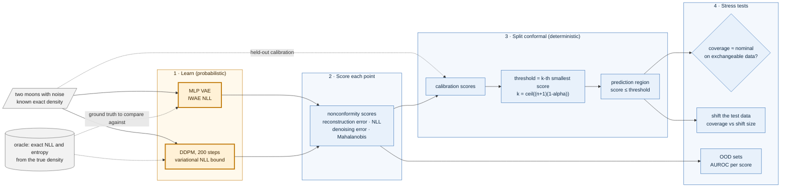
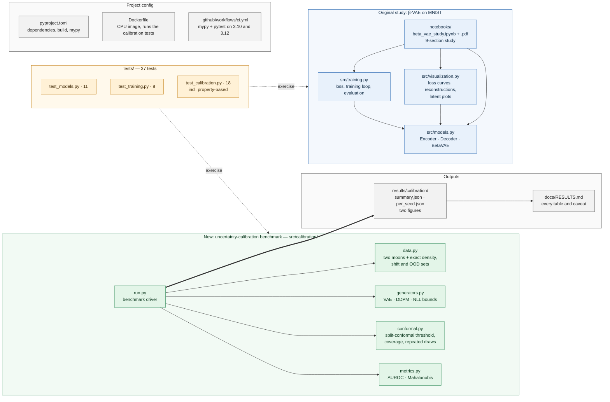

# generative-modeling-study

A from-scratch study of **β-Variational Autoencoders (β-VAE)** on MNIST, exploring how the β hyperparameter controls the trade-off between reconstruction fidelity and latent disentanglement.


## Highlights

| β Value | Reconstruction Loss | KL Divergence | Behavior |
|---------|-------------------|---------------|----------|
| 0.5 | Lowest | Highest | Sharp reconstructions, unstructured latent space |
| 1.0 | Baseline | Baseline | Standard VAE |
| 4.0 | Moderate | Low | Good disentanglement–quality balance |
| 10.0 | Highest | Lowest | Maximally disentangled, blurry outputs |

## New: uncertainty-calibration benchmark (branch `calibration-benchmark`)

**Status: new work, synthetic 2-D data only.** Everything above this heading is the original β-VAE study on MNIST and is unchanged. This section adds a second study, in `src/calibration/`, on a question the first one does not ask: *when a generative model says a point is unusual, can you trust how often it is right?*

### What is this? (plain-language overview)

A generative model such as a VAE or a diffusion model can score how "normal" a data point looks. Those scores are often used to flag anomalies, but a score alone does not say how many alarms are false or how many real problems are missed. **Split-conformal inference** fixes that for any score, however poor: set aside some data the model never trained on, find the score below which 90% of it falls, and use that as the cut-off. Then, if new data behave like the held-out data, about 90% of them will fall inside, with a guarantee that does not depend on the model being good.

This benchmark tests three things. Does that guarantee actually hold for a VAE and a diffusion model? What happens to it when the data drift? And does the same score also detect out-of-distribution points? To make the answers checkable, the data are two interleaving half-moons with noise whose exact density is known, so every model can be compared with the truth.

### What it found

| Question | Result (3 seeds, details and caveats in [docs/RESULTS.md](docs/RESULTS.md)) |
| --- | --- |
| Does the 90% guarantee hold? | **Yes, for all seven scores**, good or bad: coverage 0.895-0.902, with about ±0.022 spread across calibration draws, as theory predicts |
| What happens under covariate shift? | Coverage falls, as it must. **The better a score is at noticing the shift, the faster its coverage falls**; a score that keeps its coverage cannot see the shift |
| Which score detects OOD points best? | The diffusion scores, within 0.05-0.07 AUROC of the exact-density oracle (0.78-0.87 vs 0.84-0.92); VAE reconstruction error is among the weakest (0.62-0.69) |
| How close are the models to the true likelihood? | Neither is close: true NLL 0.77 nats, VAE 1.58, DDPM bound 3.78. The DDPM bound is inherently loose (about 3 nats even for a perfect model at 200 steps), so the VAE and DDPM numbers are not comparable |


### How it works



*Amber is the probabilistic part; blue is deterministic code. The conformal threshold, the coverage measurement and the AUROC are plain, tested code that does not depend on the model being right.*

### Run it

```bash
pip install -e ".[dev]"                          # needs PyTorch (CPU is fine)
python -m pytest tests/test_calibration.py -q    # 18 tests, about 10 s
python -m src.calibration.run --seeds 3          # the benchmark, several minutes on CPU
docker build -t gms-calibration . && docker run --rm --network none gms-calibration   # tests in a container
```

### Limitations

Two-dimensional synthetic data only; small models and three seeds; one kind of shift (translation); hand-chosen OOD sets; plain split conformal only. **Not done:** the energy-based model, real data (UCI, California Housing), MAPIE and adaptive conformal variants, a tighter DDPM likelihood. The fixed-variance DDPM bound is loose, and the VAE learns only a smooth blob around the moons. See [docs/RESULTS.md](docs/RESULTS.md) for every table and what was and was not measured.

## Project Structure



*Blue is the original MNIST β-VAE study, green is the new calibration benchmark, amber is the test suite, grey is outputs and configuration. Arrows inside a group mean "uses"; dotted arrows mean "tests"; the thick arrow is the benchmark writing its results.*

## Key Concepts

- **Reparameterization trick**: Enables backprop through stochastic sampling by expressing z = μ + σ·ε where ε ~ N(0,I)
- **ELBO loss**: L = BCE(recon, target) + β · KL(q(z|x) || p(z))
- **Disentanglement**: Higher β pushes the latent posterior toward N(0,I), encouraging independent latent factors
- **Convolutional VAE**: Stride-2 convolutions for spatial downsampling; transposed convolutions for upsampling

## PDF Report

A fully executed notebook with all outputs is available as a PDF:  
[`notebooks/beta_vae_study.pdf`](notebooks/beta_vae_study.pdf)

## Quick Start

```bash
# Install (CPU-only PyTorch recommended for local dev)
pip install torch torchvision --index-url https://download.pytorch.org/whl/cpu
pip install -e ".[dev]"

# Run tests
python -m pytest tests/ -v

# Open the study notebook
jupyter notebook notebooks/beta_vae_study.ipynb
```

## Requirements

- Python ≥ 3.10
- PyTorch ≥ 2.0
- torchvision, matplotlib, numpy, pandas

## Author

Chris Schmidt — MS Applied Mathematics | AI Engineering MSE (JHU)

## License

MIT
