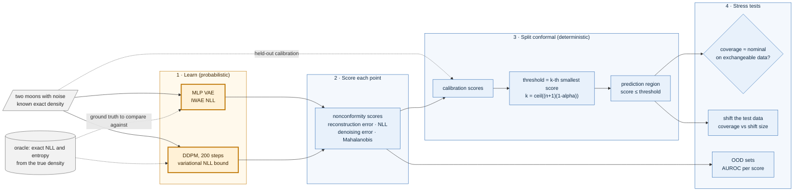
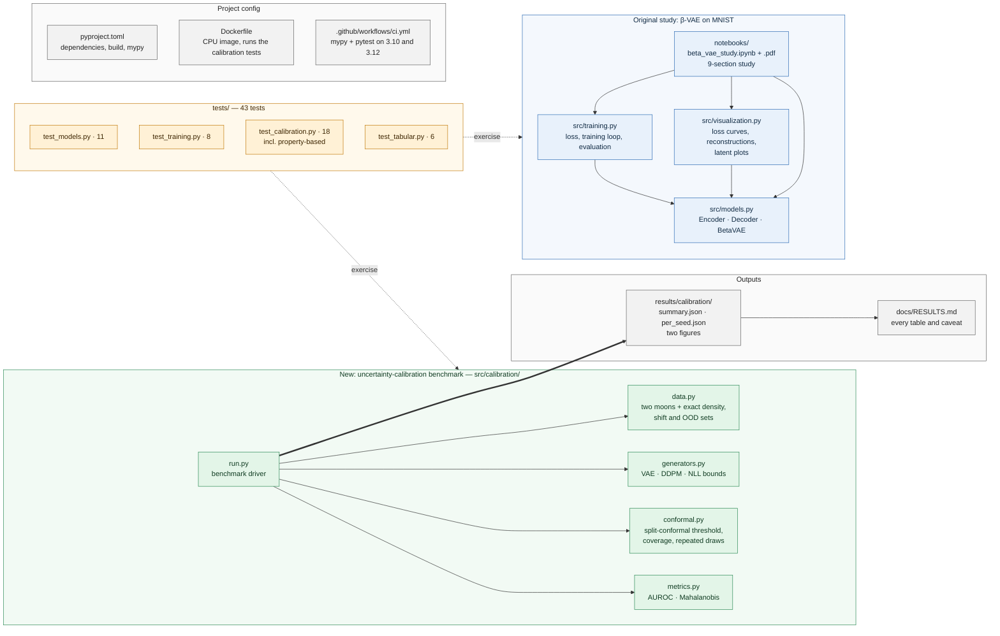
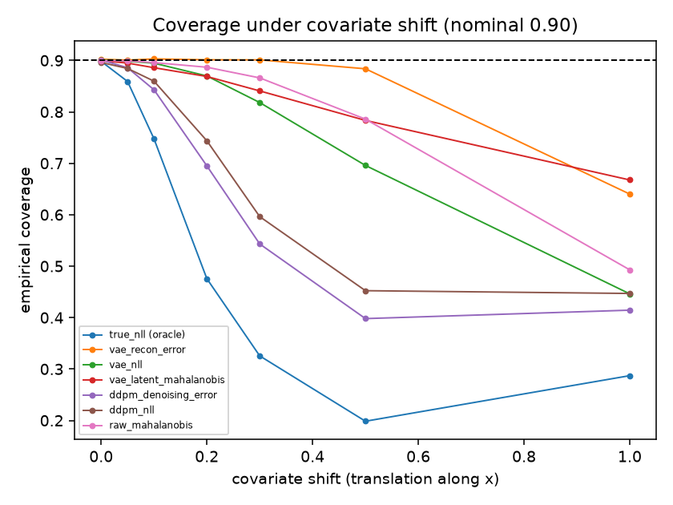

# generative-modeling-study — can you trust how often a generative model's "this looks unusual" alarm is right?


**Status: v0.2, portfolio project.** Two studies share this repository. The first is a from-scratch **β-VAE on MNIST** (the original project, unchanged). The second is an **uncertainty-calibration benchmark**: split-conformal inference on the "how normal does this point look" scores of a VAE, a diffusion model, an energy-based model and a Gaussian mixture, first on synthetic two-dimensional data with a known density and then, under a protocol written before any model was trained, on **real tabular data** (California Housing and Covertype). The headline: the conformal coverage guarantee held for every score on every dataset (0.897 to 0.907 at nominal 0.90 on the real tables), but novelty detection on Covertype was poor (best AUROC 0.70), and two of five pre-registered hypotheses were falsified ([Results](#results), [Limitations](#limitations)).

## What is this? (plain-language overview)

A generative model such as a VAE or a diffusion model can score how "normal" a data point looks. Those scores are often used to flag anomalies, but a score alone does not say how many alarms are false or how many real problems are missed. **Split-conformal inference** fixes that for any score, however poor: set aside some data the model never trained on, find the score below which 90% of it falls, and use that as the cut-off. Then, if new data behave like the held-out data, about 90% of them will fall inside, with a guarantee that does not depend on the model being good.

The benchmark asks three questions. Does that guarantee actually hold for a VAE and a diffusion model? What happens to it when the data drift? And does the same score also detect out-of-distribution points? To make the answers checkable, the first data set is two interleaving half-moons with noise whose exact density is known, so every model can be compared with the truth. The second study asks the same questions of real tables, where no true density exists.

**What it is not.** It is not a new conformal method or a state-of-the-art anomaly detector. The models are small, the conformal step is the plain split version, and the point is to measure what the guarantee does and does not buy.

### Who it is for, and when it earns its place

| If you are... | the project gives you... |
| --- | --- |
| scoring anomalies with a generative model | a worked check that the alarm rate on normal data is what you set, and a warning that this does not make the detector good |
| learning conformal prediction | a small, tested implementation with a property-based test of the guarantee |
| reviewing a model-evaluation claim | a pre-registered protocol, hypotheses with numeric criteria, and two that failed |
| learning VAEs | the original β-VAE study with a sweep, notebook and PDF report |

It is a poor fit if you need adaptive or conditional conformal methods, large models, or results on image or text data.

## At a glance

| | |
| --- | --- |
| Models | MLP VAE, DDPM (200 steps), energy-based model (noise-contrastive), Gaussian mixture baseline, and the original convolutional β-VAE |
| Guarantee tested | split-conformal coverage at nominal 0.90, with no shift and under covariate shift |
| Measured (synthetic, 3 seeds) | coverage 0.895 to 0.902 for all seven scores; diffusion-score OOD AUROC 0.78 to 0.87 against 0.84 to 0.92 for the exact-density oracle |
| Measured (real tables, 10 test seeds run once) | coverage 0.897 to 0.907; Covertype novelty AUROC at most 0.70 |
| Pre-registered hypotheses | T1, T3, T5 held; T2 and T4 falsified |
| Stack | Python, PyTorch (CPU is fine for the tests), NumPy, scikit-learn |
| Tests | 43, including property-based; `mypy`; CI on Python 3.10 and 3.12 |

## Architecture at a glance

How the calibration benchmark turns a model into a checked alarm:


*Amber is the probabilistic part; blue is deterministic code. The conformal threshold, the coverage measurement and the AUROC are plain, tested code that does not depend on the model being right.*

How the repository is organised:


*Blue is the original MNIST β-VAE study, green is the calibration benchmark, amber is the test suite, grey is outputs and configuration. Arrows inside a group mean "uses"; dotted arrows mean "tests"; the thick arrow is the benchmark writing its results.*

## Quickstart

```bash
pip install torch torchvision --index-url https://download.pytorch.org/whl/cpu
pip install -e ".[dev]"

python -m pytest tests/ -q                        # 43 passed
python -m src.calibration.run --seeds 3           # the synthetic benchmark, several minutes on CPU
jupyter notebook notebooks/beta_vae_study.ipynb   # the original β-VAE study (or read the executed PDF)
docker build -t gms-calibration . && docker run --rm --network none gms-calibration   # calibration tests in a container
```

The tabular study needs the `study` extra (`pip install -e ".[dev,study]"`, PyTorch with CUDA recommended); its datasets download from their original hosts and stay out of git. [docs/PROTOCOL_TABULAR.md](docs/PROTOCOL_TABULAR.md) and [docs/RESULTS_TABULAR.md](docs/RESULTS_TABULAR.md) give the order of the runs. A fully executed notebook is in [notebooks/beta_vae_study.pdf](notebooks/beta_vae_study.pdf), and [DEMO_GUIDE.md](DEMO_GUIDE.md) walks through the β-VAE demo.

## Approach: why it is built this way

- **Truth first.** The synthetic data have an exact density, so each model's likelihood and each score can be compared with the right answer instead of with another model.
- **Separate the guarantee from the usefulness.** Coverage on normal data and detection of abnormal data are measured separately, because the first can hold for a score that does the second badly.
- **Write the prediction down first.** For the real-data study the hypotheses, criteria, grid of choices and seeds were fixed and pushed before any model was trained; choices were made on development seeds from a separate pool of rows, and ten test seeds were run once.
- **Keep the wrong predictions.** Two of five hypotheses failed and are reported as failures.
- **Small and checkable.** Small seeded models and a property-based test of the conformal guarantee.

## Motivation

This began as a coursework-style β-VAE study and grew into a measurement question I care about: a generative model gives a number for "how unusual", and engineers need to know what that number lets them promise. It follows the same philosophy as the rest of this portfolio: the probabilistic model proposes a score, and deterministic, tested code (the conformal threshold, the coverage count) decides what to claim.

## Method (what the benchmark actually does)

1. **Data.** Synthetic: two interleaving half-moons with noise, an exact density, and shifted and out-of-distribution test sets. Real: California Housing (the southern half is in-distribution; northern bands are shifted) and Covertype (three of seven classes held out as novel).
2. **Models.** MLP VAE (importance-weighted NLL), DDPM with a variational bound, an energy-based model trained by noise-contrastive estimation, and a Gaussian mixture. Each yields one or more scores: reconstruction error, negative log-likelihood, denoising error, Mahalanobis distance.
3. **Split conformal.** Hold out calibration data, take the k-th smallest score with k = ceil((n+1)(1-alpha)) as the threshold, and call a point "inside" if its score is at or below it.
4. **Stress tests.** Coverage on exchangeable data, coverage as the test data are shifted, and AUROC for out-of-distribution points, per score and per seed, with paired comparisons.

## Results

Full tables and caveats: [docs/RESULTS.md](docs/RESULTS.md) (synthetic) and [docs/RESULTS_TABULAR.md](docs/RESULTS_TABULAR.md) (real tables).

### Synthetic two-dimensional data (3 seeds)

| Question | Result |
| --- | --- |
| Does the 90% guarantee hold? | **Yes, for all seven scores**, good or bad: coverage 0.895-0.902, with about ±0.022 spread across calibration draws, as theory predicts |
| What happens under covariate shift? | Coverage falls, as it must. **The better a score is at noticing the shift, the faster its coverage falls**; a score that keeps its coverage cannot see the shift |
| Which score detects OOD points best? | The diffusion scores, within 0.05-0.07 AUROC of the exact-density oracle (0.78-0.87 vs 0.84-0.92); VAE reconstruction error is among the weakest (0.62-0.69) |
| How close are the models to the true likelihood? | Neither is close: true NLL 0.77 nats, VAE 1.58, DDPM bound 3.78. The DDPM bound is inherently loose (about 3 nats even for a perfect model at 200 steps), so the VAE and DDPM numbers are not comparable |



### Real tabular data (pre-registered; ten test seeds, run once)

Plan in [docs/PROTOCOL_TABULAR.md](docs/PROTOCOL_TABULAR.md), pushed before any model was trained.

- **Coverage held on real data** for every score (0.897 to 0.907 at nominal 0.90) (T1).
- **Novelty detection on Covertype is poor for all scores** (best AUROC 0.70; 64 to 75% of novel rows still fall inside the 90% region), and ranking is noisy across seeds because it depends on which classes are novel.
- **My hypothesis that no deep score would beat a tuned mixture model was falsified** (T2): the DDPM and VAE reconstruction error beat it by about 0.05 AUROC, with the mixture capped at 16 components, the edge of its grid. VAE reconstruction error, among the weakest scores in 2-D, was competitive here (T4 falsified). A far better likelihood (VAE 0.69 against GMM 3.78 nats) did not give a better detector.
- California Housing's shift is trivially detectable (latitude is a feature); coverage fell monotonically with distance in 10 of 10 seeds for every density score (T5).

### The original β-VAE study (MNIST)

| β | Reconstruction loss | KL divergence | Behaviour |
| --- | --- | --- | --- |
| 0.5 | Lowest | Highest | Sharp reconstructions, unstructured latent space |
| 1.0 | Baseline | Baseline | Standard VAE |
| 4.0 | Moderate | Low | Good disentanglement-quality balance |
| 10.0 | Highest | Lowest | Maximally disentangled, blurry outputs |

## Limitations

- **Synthetic study:** two-dimensional data only; small models and three seeds; one kind of shift (translation); hand-chosen OOD sets; plain split conformal only.
- **Real tables:** two datasets, ten seeds that share rows, one author who wrote the models and the protocol. Covertype results vary a lot with which classes are novel (standard deviation 0.09 to 0.14 AUROC), so score rankings are noisy.
- The GMM baseline is capped at the edge of its grid (16 components), so the falsified T2 is a statement about that cap as much as about mixtures.
- The fixed-variance DDPM bound is loose, and the VAE learns only a smooth blob around the moons.
- The β-VAE study is a single MNIST sweep for learning, not a benchmark.

## Known gaps against the original roadmap

The project began as an item in a longer roadmap that named a larger scope. These parts were **not built**; the results above say nothing about them.

- Swiss Roll and warped-mixture manifolds (two interleaving half-moons were used).
- UCI Sensorless Drive (it could not be downloaded here; California Housing and Covertype were used).
- MAPIE and adaptive or conditional conformal variants (plain split conformal is implemented here).
- A latent diffusion model (a plain DDPM on the data space was used).
- Weights & Biases or aim experiment tracking.
- Classification-style ECE (a coverage-calibration error is reported and labelled as such).

## Operational notes

### What runs where

The tests and the synthetic benchmark run locally on a CPU (the benchmark takes several minutes). The tabular study trains larger models and was run with a CUDA GPU. The Docker image runs the calibration tests with `--network none`.

### Data and keys

No keys. MNIST, California Housing and Covertype download on demand and are never committed.

### Verify the claims (a reviewer's path)

```bash
pytest -q                                   # 43 passed, includes a property test of the conformal guarantee
python -m src.calibration.run --seeds 3     # the synthetic table above
```

### Documentation map

| Doc | What it covers |
| --- | --- |
| [docs/RESULTS.md](docs/RESULTS.md) | the synthetic benchmark: every table and what was not measured |
| [docs/PROTOCOL_TABULAR.md](docs/PROTOCOL_TABULAR.md), [docs/RESULTS_TABULAR.md](docs/RESULTS_TABULAR.md) | the pre-registered real-data study and its results |
| [DEMO_GUIDE.md](DEMO_GUIDE.md) | the β-VAE demo walk-through |
| [notebooks/beta_vae_study.pdf](notebooks/beta_vae_study.pdf) | the executed β-VAE notebook |
| [src/calibration/conformal.py](src/calibration/conformal.py) | the split-conformal threshold and coverage code |

## Glossary

- **Split-conformal inference**: set aside held-out calibration data and use a quantile of its scores as the cut-off, so that coverage on exchangeable new data is guaranteed to be about 1 - alpha.
- **Coverage**: the share of new points whose score falls at or below the cut-off.
- **Nonconformity score**: any number that grows as a point looks less normal (reconstruction error, negative log-likelihood, denoising error, Mahalanobis distance).
- **AUROC**: the chance a randomly chosen abnormal point scores higher than a randomly chosen normal one (0.5 is chance).
- **Covariate shift**: the inputs change distribution between calibration and use, which breaks the exchangeability the guarantee needs.
- **ELBO**: the VAE training objective, reconstruction error plus beta times the KL divergence.
- **Reparameterization trick**: write z = mu + sigma * eps with eps drawn from N(0, I), so gradients can flow through sampling.
- **Disentanglement**: a higher beta pushes the latent posterior toward N(0, I), encouraging independent latent factors.

## License

MIT. See [LICENSE](LICENSE).

## Author

Chris Schmidt ([PCSchmidt](https://github.com/PCSchmidt)). Part of a portfolio on evaluator-gated AI systems: probabilistic components propose, deterministic gates decide.
