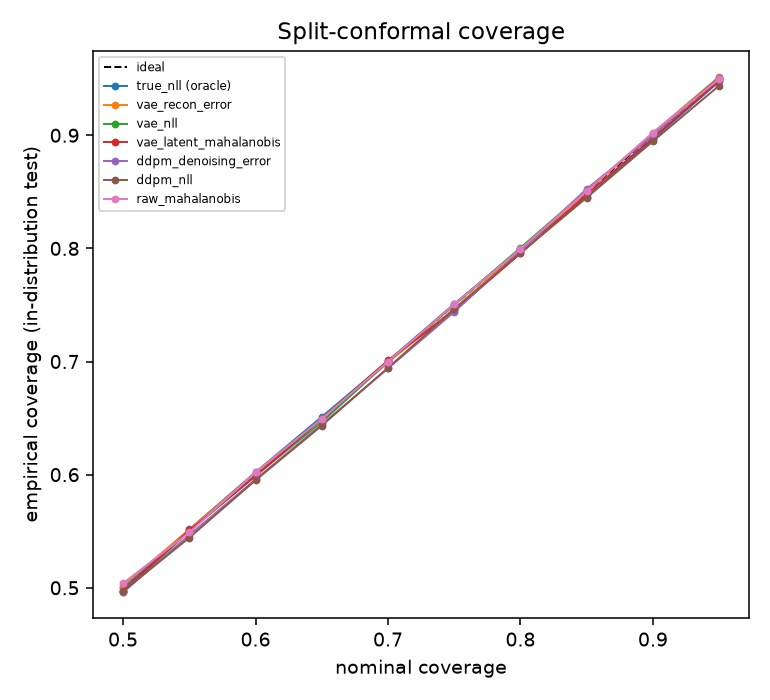

# Results: uncertainty calibration of generative models

A benchmark of what a VAE and a diffusion model (DDPM) know about their own uncertainty, using **split-conformal inference** to turn their scores into prediction regions with a coverage guarantee, then stress-testing that guarantee under covariate shift and out-of-distribution (OOD) data.

Everything is **synthetic and two-dimensional**. That is deliberate: the data-generating process is known exactly, so every model can be compared against the true density and the true entropy. It also means none of this is evidence about image or tabular models, and the real-data parts of the original plan are not done (see [Not done](#not-done)).

## Setup

**Data.** Two interleaving half-moons with heteroscedastic Gaussian noise: noise standard deviation `0.05 * (1 + sin t)` along each arc, so it is largest at the top of the arc. The exact log-density is computed by numerical integration over the arc angle (it integrates to 1.000 on a fine grid, and a Monte-Carlo check agrees with quadrature; both are tests). The entropy of the data is therefore known: **0.768 nats** (test-set mean).

**Models** (small, CPU, seeded):

| Model | Detail | Score(s) used |
|---|---|---|
| MLP VAE | latent dim 2, Gaussian decoder with learned per-dimension variance, 6,000 steps | reconstruction error; IWAE negative log-likelihood (128 samples); Mahalanobis distance in latent space |
| DDPM | 200 steps, linear schedule, MLP noise predictor, 20,000 steps | mean denoising error over all 200 timesteps; full variational bound on the NLL |
| Baselines | | oracle NLL from the exact density; Mahalanobis distance in the raw 2-D input (one Gaussian) |

**Splits per seed.** 8,000 training points; a 20,000-point calibration pool; 5,000 in-distribution test points; three 5,000-point OOD sets. Three seeds; each seed redraws the data and reinitialises the models.

**Split-conformal.** For a score where higher means more unusual, the threshold is the `ceil((n+1)(1-α))`-th smallest calibration score, giving `P(new score ≤ threshold) ≥ 1-α` for exchangeable data. Calibration sets of 500 points were drawn repeatedly from the pool (300 draws for the headline figure, 60 elsewhere) so that the spread of coverage, not just its mean, is visible.

**Protocol notes.** Training length and architecture were decided on separate development data (seed 100) before the benchmark, by checking whether longer training helped: it did for the DDPM and not for the VAE. No hyperparameter search beyond that was done, and the benchmark seeds (0-2) were not used for any choice. Reproduce with `python -m src.calibration.run --seeds 3` (several minutes on a laptop CPU; each seed trains both models for about a minute).

## 1. Likelihood: how close do the models get to the truth?

| Quantity | Test NLL (nats), mean ± sd over 3 seeds |
|---|---|
| true (entropy) | 0.768 ± 0.021 |
| VAE, IWAE estimate (128 samples) | 1.578 ± 0.000 |
| DDPM, full variational bound | 3.777 ± 0.042 |

- **Neither model is close to the truth**, and **the two numbers are not comparable to each other.** The IWAE estimate is a fairly tight upper bound on the VAE's NLL. The DDPM bound with fixed reverse-process variances is inherently loose: even a *perfect* noise predictor (an analytic oracle on Gaussian data, which is a test in this repo) has its variational bound sit about 3.2 nats above its true marginal NLL at T=200, and about 0.9 nats above at T=1000. So the DDPM's 3.78 is mostly bound looseness, and a tighter DDPM likelihood (for example from the probability-flow ODE) would be needed to rank it against the VAE on NLL. This is not done.
- The VAE did **not** collapse to a single Gaussian (a single Gaussian fitted to the data scores 1.91 on development data; the VAE scores 1.59 and uses about 1.9 nats of latent information), but its per-point likelihood tracks the true one only weakly (correlation 0.13 on development data). It learned a smooth blob around the moons.
- The three-seed standard deviation of the VAE value is 0.0003, which is far smaller than the sampling spread of a single model across test sets (about 0.002-0.01). That agreement is coincidence: retraining each seed's model and cross-evaluating it on all three test sets reproduces the numbers. Treat the "sd" column as unreliable at n=3.

## 2. Does split-conformal deliver its coverage guarantee?

Nominal 90% coverage, in-distribution test data, calibration sets of 500:

| Score | Coverage at nominal 0.90 | 5th-95th pct over calibration draws | Coverage ECE |
|---|---|---|---|
| true_nll (oracle) | 0.898 ± 0.008 | 0.874 – 0.918 | 0.0105 ± 0.0057 |
| vae_recon_error | 0.902 ± 0.006 | 0.880 – 0.922 | 0.0038 ± 0.0016 |
| vae_nll | 0.901 ± 0.005 | 0.878 – 0.921 | 0.0029 ± 0.0010 |
| vae_latent_mahalanobis | 0.897 ± 0.008 | 0.875 – 0.918 | 0.0052 ± 0.0008 |
| ddpm_denoising_error | 0.901 ± 0.005 | 0.879 – 0.920 | 0.0050 ± 0.0035 |
| ddpm_nll | 0.895 ± 0.004 | 0.872 – 0.916 | 0.0056 ± 0.0019 |
| raw_mahalanobis | 0.900 ± 0.006 | 0.878 – 0.921 | 0.0038 ± 0.0012 |

"Coverage ECE" here is the mean absolute gap between nominal and empirical coverage over levels 0.50 to 0.95. It is a coverage-calibration error, not the classification ECE of the same name.

- **The guarantee holds for every score, including poor ones.** All seven scores land at 0.895-0.902. The 5th-95th percentile band across calibration draws (about ±0.022) matches the Beta(451, 50) spread that theory predicts for n=500, so a single calibration set can be about two points off in either direction even when everything is correct.
- **Coverage ECE is 0.003-0.011 for all scores.** The oracle's value is the largest, but its seed-to-seed sd is about as large as the differences, so there is no ranking here.
- This is the point of conformal inference: validity does not depend on the model being good. What the score choice changes is how *informative* the region is, which is what the next two sections measure.

## 3. What happens to coverage under covariate shift?

Test points translated along x by the stated amount; thresholds still calibrated on unshifted data; nominal 0.90; mean of 60 calibration draws and 3 seeds.

| Score | shift 0.0 | shift 0.05 | shift 0.1 | shift 0.2 | shift 0.3 | shift 0.5 | shift 1.0 |
|---|---|---|---|---|---|---|---|
| true_nll (oracle) | 0.898 | 0.859 | 0.748 | 0.476 | 0.326 | 0.198 | 0.287 |
| vae_recon_error | 0.902 | 0.901 | 0.903 | 0.901 | 0.901 | 0.884 | 0.640 |
| vae_nll | 0.901 | 0.898 | 0.895 | 0.870 | 0.818 | 0.696 | 0.446 |
| vae_latent_mahalanobis | 0.899 | 0.895 | 0.886 | 0.869 | 0.841 | 0.783 | 0.668 |
| ddpm_denoising_error | 0.901 | 0.886 | 0.843 | 0.695 | 0.543 | 0.398 | 0.414 |
| ddpm_nll | 0.896 | 0.884 | 0.860 | 0.744 | 0.596 | 0.452 | 0.447 |
| raw_mahalanobis | 0.900 | 0.899 | 0.896 | 0.887 | 0.866 | 0.786 | 0.493 |

- **The guarantee fails, as theory says it must, once the data stop being exchangeable with the calibration set.** There is no surprise in the failure; the useful measurement is *how fast* it fails.
- **Sensitivity to shift is the same thing as ability to notice it.** The oracle density score loses coverage fastest (0.48 at a shift of 0.2); the DDPM scores come next (0.70 and 0.74); the VAE likelihood loses it slowly (0.87); and the VAE reconstruction error barely notices a shift of 0.5 (0.88). A score that keeps its coverage under shift is a score that cannot see the shift. So "robust coverage" is not a goal in itself: it is a symptom of a weak score.
- At shift 1.0 the oracle's coverage rises slightly (0.20 at 0.5, 0.29 at 1.0). My explanation, not tested here, is geometry: translating by 1.0 moves each moon partly onto the region the other occupied.
- Only translation along one axis was tested.

## 4. Out-of-distribution detection

AUROC for separating the 5,000 in-distribution test points from each OOD set, using the same scores (0.5 is chance; mean ± sd over 3 seeds):

| Score | shifted_by_1.0 | uniform_box | wide_gaussian |
|---|---|---|---|
| true_nll (oracle) | 0.842 ± 0.008 | 0.920 ± 0.002 | 0.916 ± 0.005 |
| vae_recon_error | 0.693 ± 0.004 | 0.690 ± 0.013 | 0.615 ± 0.013 |
| vae_nll | 0.764 ± 0.003 | 0.817 ± 0.004 | 0.788 ± 0.006 |
| vae_latent_mahalanobis | 0.577 ± 0.029 | 0.695 ± 0.015 | 0.695 ± 0.012 |
| ddpm_denoising_error | 0.786 ± 0.006 | 0.870 ± 0.002 | 0.848 ± 0.003 |
| ddpm_nll | 0.781 ± 0.005 | 0.849 ± 0.003 | 0.847 ± 0.003 |
| raw_mahalanobis | 0.669 ± 0.005 | 0.760 ± 0.002 | 0.716 ± 0.003 |

- **The diffusion scores get within about 0.05-0.07 AUROC of the oracle** on all three OOD sets, and beat every VAE score on all three. The cheap denoising error is at least as good as the (loose) variational bound: better on the shifted and box sets, essentially tied on the Gaussian set.
- **The VAE's reconstruction error and latent Mahalanobis distance are the weakest scores**, below even a single Gaussian fitted in the raw input on the box and Gaussian sets. A 2-D VAE reconstructs nearly any 2-D point, so reconstruction error says little about whether a point is plausible.
- The oracle sets the ceiling for a density-based score on this task (0.84-0.92). That the ceiling is not near 1.0 is a property of the OOD sets chosen: a shift of 1.0 and a wide Gaussian both overlap the moons' support.
- The shift-sensitivity order in section 3 and the AUROC order here agree at the top (oracle, then DDPM, then VAE likelihood) but not at the bottom, where the reconstruction error and latent Mahalanobis scores swap places. I would not claim more than "broadly similar" from seven scores.

## Limitations

- **Two-dimensional synthetic data only.** Nothing here transfers automatically to images, tabular or sensor data.
- **Small models, short training, three seeds.** The VAE is a weak baseline (it learns a smooth blob), and 3 seeds make the sd columns rough.
- **The DDPM NLL is a loose bound** and is not comparable to the VAE's. A tighter likelihood was not computed.
- **One kind of shift** (translation) and **three hand-chosen OOD sets.** AUROC depends on how much the OOD set overlaps the data, and these overlap partially.
- **Exchangeability is assumed** by the conformal guarantee; the shift experiment is a deliberate violation, not a failure of the method.
- **Calibration-set size** is fixed at 500 for the headline numbers; smaller sets would widen the spread shown in section 2.
- **Development choices** (training length) were made on separate data, but they were made by looking at likelihood, not blind.

## Not done

- The **energy-based model** named in the original plan.
- **Real data** (UCI Sensorless Drive, California Housing, telemetry).
- **MAPIE** and other conformal variants (adaptive or localised, conformalised quantile regression); only plain split conformal is implemented here.
- A **tighter DDPM likelihood**, per-point **adaptive** prediction sets, and experiment tracking (Weights & Biases or aim).
- Running the **full benchmark** inside the container: the image builds and the 18 calibration tests pass in it with `--network none`, but the 3-seed benchmark itself was run on the host.

## Verified

- 18 new tests (37 including the original MNIST study's 19): exact density integrates to 1 and agrees with its sampler; conformal quantile on known cases; **the coverage guarantee for exchangeable scores matches its exact expectation `ceil((n+1)(1-α))/(n+1)`** within 4.5 Monte-Carlo standard errors (property-based); coverage fails when scores are shifted; AUROC known cases and antisymmetry; Mahalanobis basics; VAE and DDPM shapes, determinism and upper-bound property; and **the DDPM variational bound against an analytic Gaussian oracle**, including that its looseness shrinks as T grows.
- `mypy --strict` on the new package and its tests; ruff.
- Two flaws found while testing, both mine: a property test whose tolerance was about 2.3 standard errors (it failed on a rare example; replaced with an exact-expectation test), and the DDPM bound's looseness, found by checking an oracle before trusting the number.
- The repository's `pyproject.toml` named a nonexistent build backend (`setuptools.backends._legacy:_Backend`), so `pip install -e .` could not work and CI on `main` had been failing since April. Changed to `setuptools.build_meta` on this branch; that is what made the Docker build possible.
