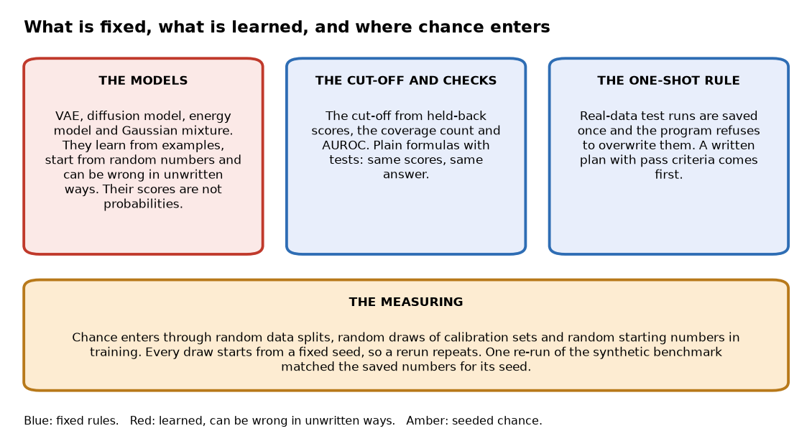
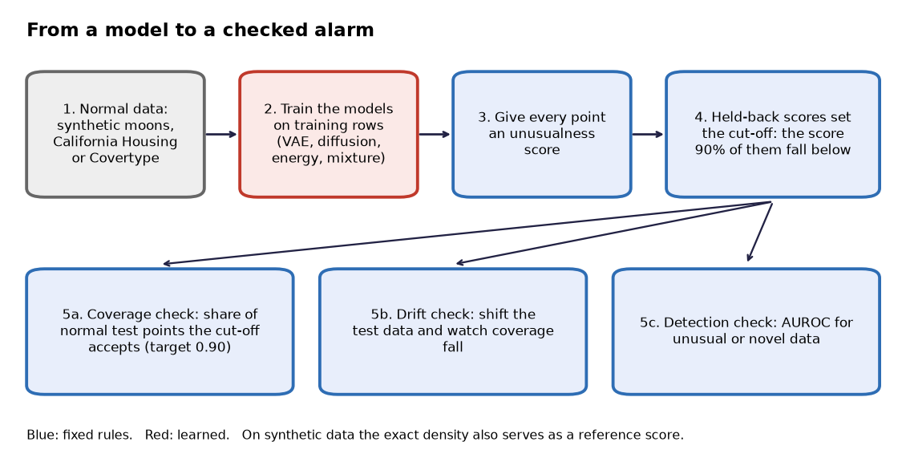
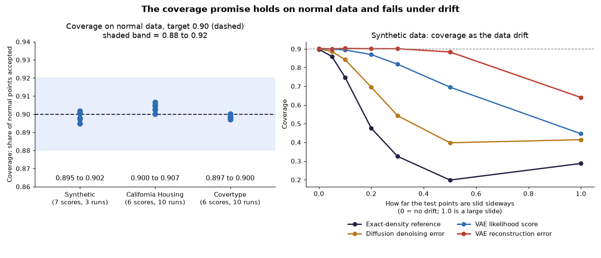
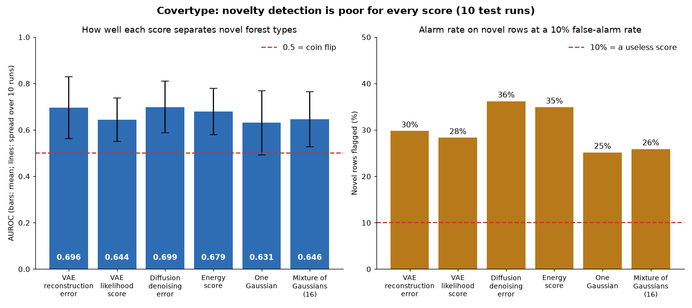

# generative-modeling-study

*A measurement study of whether a "this looks unusual" alarm built on a generative AI model can be trusted: how often it fires on normal data, how it behaves when data drift, and how well it spots data of a kind it has never seen.*

Status: version 0.2, a portfolio study, built in two stages: a small handwritten-digit study in April 2026, and the main calibration work in October 2026. Code: https://github.com/PCSchmidt/generative-modeling-study (under the MIT (Massachusetts Institute of Technology) licence, a permissive open-source licence that lets anyone reuse the code). It is not deployed, and nothing shows that anyone but me has used it.

**The plain conclusion.** A simple recipe lets you set the false-alarm rate of an unusualness alarm in advance, and it worked: the alarm rang on about 10% of normal data for every score tried, good or bad. But the alarms were weak at spotting data of a kind the models had never seen. On the harder real table, the best score caught only about a third of the unfamiliar rows. So the recipe controls false alarms, and nothing in it makes the detector good. Two of the five predictions written down before the real-data run turned out wrong.

Imagine a factory sensor that sends in ten numbers every minute. A generative model, an AI model that learns what normal data looks like, can give each new reading an unusualness score. A high score means "this does not look like what I was trained on". People use such scores as alarms. The trouble is that a score alone does not say how often the alarm will ring for no reason, or how many real problems it will miss.

This project tests a fix that works with any score. Hold back some normal data the model never trained on. Find the score that 90% of that held-back data falls below, and use it as the cut-off. This recipe is called split-conformal inference. If new normal data behave like the held-back data, the alarm should ring on about 10% of them, whatever the model is. The promise is about normal data only. It says nothing about whether the alarm catches abnormal data.

So the study measures two things separately. Coverage is the share of normal points the cut-off accepts without an alarm; the target is 0.90. Detection is how well the score separates normal from unusual data, summarised by AUROC (Area Under the Receiver Operating Characteristic curve): the chance that a randomly chosen unusual point scores higher than a randomly chosen normal one, where 0.5 is a coin flip and 1.0 is perfect.

The headline figures: coverage landed between 0.895 and 0.907 on synthetic data and two real tables. The best detection score on the harder table was an AUROC of 0.70. The limits are the ones you would expect: small models, two real tables, ten test runs that reuse the same underlying rows, and one author. I state them here once and do not repeat them chapter by chapter.

Here is what is fixed and what is learned. A calculator is deterministic: the same input always gives the same answer. A weather forecast is probabilistic: a best guess that can be wrong. The cut-off, the coverage count and the AUROC are calculators; they are plain formulas with tests. The generative models are the forecast. They learn from examples, start from random numbers, and can be wrong in ways nobody wrote down. Their scores are not probabilities. Chance also enters the measuring, because the data are split at random and the calibration sets are drawn at random many times. Every draw starts from a fixed starting number (a seed), so a rerun repeats. One re-run of the synthetic benchmark gave exactly the saved numbers for its seed. A repeatable result is not a correct one, and the results chapter shows where these scores fail.



AI coding agents wrote almost all of the code. I directed the scope, plan, architecture and preferences. If you have ten minutes, read the chapters on what it does, the results, and the strengths and shortcomings.

## What problem this solves

Anyone who uses a model to flag odd data has the same problem: a sensor stream, a transaction feed, a batch of images. Without a measured cut-off, someone picks a threshold by feel. Then nobody knows whether "alarm" means one false alarm in ten, in a hundred or in two. The usual alternatives are tuning the threshold by hand until the alarms look sensible, or using a purpose-built anomaly detector. The first gives no stated rate. The second may be excellent, but it still needs its own cut-off.

The people with this problem are engineers who put a score in front of an operator. I treat that as the intended reader, not as proven demand. Defense-related analysis is of interest to me, and calibrated alarms matter there, but nothing in this project uses defense data.

The project began as a coursework-style study of one model, a VAE (Variational Autoencoder: a model that squeezes each input into a short code and rebuilds it), and grew into a question: a generative model gives a number for "how unusual", and engineers need to know what that number lets them promise. The goal has two parts. The first is a measurement: does the promise hold for a VAE and for a diffusion model (a model that learns to remove noise that has been added to data), under drift, and on real data? The second is evidence discipline: the real-data study had a written plan with numeric pass criteria, and two of its five predictions failed and were reported as failures.

The project does not offer a new method or a state-of-the-art detector. The recipe is the plain textbook version and the models are small. The README lists roadmap items that were not built, such as more data shapes, a third real table and fancier variants of the recipe; the results say nothing about those.

A skeptic would ask, "Why not use a tuned anomaly detector and skip the generative model?" The project does not compare against one. It compares generative scores against each other, against a single bell-shaped cloud, against a mixture of clouds, and, on synthetic data, against the exact answer.

In short, the project asks what a generative alarm can promise, and measures it instead of assuming it.

## What it does, step by step

There are three studies in one repository. The oldest trains a VAE on handwritten digits; I give it one short paragraph in the results. The second is a benchmark on synthetic two-dimensional data where the true answer is known exactly. The third repeats the questions on two real tables under a pre-written plan.

The best everyday comparison is a smoke detector with a test button. The model is the sensor. The cut-off is how sensitive the detector is set, chosen by burning a few hundred pieces of toast and noting where the alarm should sit so it rings for at most one toast in ten. The comparison breaks down at the end: the toast test tells you the false-alarm rate, but nothing about whether the detector rings for a real fire.

Here is the cut-off recipe with a toy example. Say 20 held-back normal readings have unusualness scores 1, 2, 3, up to 20. I want a 10% false-alarm rate. A new normal reading is equally likely to land in any of the 21 gaps among those 20 scores (below the lowest, between neighbours, above the highest). It falls at or below the 19th smallest score in 19 of the 21 gaps, which is 90.5%. So the cut-off is 19. With only nine scores, a 5% rate cannot be promised at all, and the code returns an infinite cut-off, meaning the alarm would never ring.

**The formula, if you want it.** With n held-back scores and a false-alarm rate α, the cut-off is the k-th smallest score, where k = ceil((n + 1)(1 − α)). Ceil means round up. For n = 20 and α = 0.1, k = ceil(18.9) = 19. If k is bigger than n, no finite cut-off can keep the promise.

The promise comes with a condition: new data must come from the same source as the held-back data, in no special order. When data drift, meaning the inputs change between calibration and use, the promise is void. The study measures how fast.

Then comes detection. Here is AUROC with a toy example. Normal scores 1, 2, 3 and unusual scores 2.5 and 4 make six normal-versus-unusual pairs. The unusual score is higher in five of them, so AUROC is 5 of 6, or 0.83.

A person appears nowhere in the chain. The output is a table of numbers per score and dataset. Using this on real alarms in a regulated setting would need approved data handling, a documented false-alarm policy, and monitoring for drift, none of which exists here.

In short, a fixed-rate cut-off is easy to compute, and its promise covers normal data only.

## The parts, the data and the tools

The repository has four working parts. A data part makes the synthetic data and loads the real tables. A models part trains the VAE, the diffusion model, an energy model and a mixture. A conformal part computes cut-offs, coverage and AUROC, written out by hand so tests can check them against known answers. A runner trains, scores and writes results. A separate original part holds the digit study.



Two rules matter. The calibration data must never be training data, and tests check that the parts do not overlap. And on the real tables the test runs happen once: the program refuses to overwrite its saved test results.

The synthetic data are two interleaving half-moons of points, like two crescents hooked together, with noise that is largest at the top of each arc. Because I know the recipe that generated them, the exact probability of any point can be computed, which gives every model an absolute reference. Each run draws 8,000 training points, a pool for calibration, 5,000 normal test points and three sets of unusual points: the moons slid sideways, a flat box of points, and a wide bell-shaped cloud.

The real data are two public tables. California Housing has about 20,000 neighbourhood rows from the 1990 US census; the southern half is "normal" and two northern bands are the unusual sets. Covertype has about 580,000 rows of terrain measurements for forest patches, in seven forest types; three types, picked at random each run, count as novel and the other four as normal. Rows are assigned to a development pool or a test pool by a fixed fingerprint of the row number, so the assignment cannot drift. Both tables download on demand and are not committed; their licences were not checked here. The tables carry no private data.

The program is written in Python. Training is the slowest step: about 80 seconds per run for the synthetic pair on an ordinary processor, and roughly two minutes per run and table on a graphics card for the real tables. Nothing costs money beyond the data download. Results are saved as plain data files, one per run, so any number can be traced.

In short, the repository is four small parts, two rules that protect the test, and public data that cost nothing to download.

## The methods and the models

Two measurement ideas carry the work, and both appear above: the cut-off recipe and AUROC. A third is paired comparison. With ten runs, two scores are compared run by run, and the study reports a rough 95% range for the difference, found by redrawing the ten runs at random many times. With only ten runs these ranges are rough.

One more idea explains a surprising result later. A likelihood is how probable a model thinks a point is; an unusual point has a low likelihood. On the synthetic moons the exact value is known, so a model's distance from it is visible. The diffusion model can only give a loose estimate (a bound, a number guaranteed to be on one side of the truth), and one test in the repository shows the bound sits well above the truth even for a perfect model. So I do not compare likelihood numbers across the two model families.

Five kinds of model appear. All are small and trained from random numbers in this repository; none was downloaded or pre-trained.

- **The VAE** compresses a point to a short code and rebuilds it. It gives three scores: how badly the rebuild misses (reconstruction error), how unlikely the point is, and how far its code sits from the typical code.
- **The diffusion model** adds noise to a point in 200 small steps and learns to guess the noise. Its score is how badly it guesses, averaged over the steps: a normal-looking point is easy to clean up.
- **The energy model** gives each point a number called its energy, low for normal points. It learns by telling real points from points drawn from a plain bell-shaped cloud. It appears only in the real-data study.
- **One bell-shaped cloud** measures how far a point is from the centre of the data, in the data's own stretched units. It is the cheapest possible yardstick.
- **A mixture of clouds** blends up to 16 bell-shaped clouds. It is the stronger classical rival, and the one every deep score is compared against.

Why these models? The README says the aim was a VAE versus a diffusion model, with the energy model and real data added later. Beyond that, the repository does not say why this particular set. Real alternatives include models with exact likelihoods and purpose-built detectors; none is tried.

What they get wrong is the heart of the results. On the moons, the VAE learns only a smooth blob, and its likelihood tracks the true one poorly. The diffusion estimate is too loose to rank. The mixture reached the top of its search grid (16 clouds) on both tables, so it may be under-fitted, and one result depends on that. Settings such as code size were chosen on a separate development pool, using only validation loss and no unusual data. One oddity is unexplained: for the California VAE, the likelihood measured on the validation rows during tuning (about 16.5) was far worse than on the final test rows (about 7.2), though both come from the same data. It does not touch the coverage figures, but I cannot say why. No human reviews anything, and the models are rebuilt from seeds, so no weight files need versioning.

In short, five small models are compared, and the likelihood number does not decide which one detects best.

## Edge cases, tests and safeguards

There are 43 tests, and all pass in a scratch copy outside the repository with current library versions. A type checker (a tool that reads code for mismatched kinds of data) passes on the new packages, but is not run on the original digit code.

Some tests are strong. One generates many random inputs and checks that coverage matches its exact theoretical value. Another checks that the exact probability of the synthetic data adds up to 1 and agrees with its sampler. A test that coverage fails when the scores shift confirms that the promise breaks when its condition does. The real-data scripts have no tests beyond the pieces they use, and the real-data runs were not repeated here, because they need a large download and a graphics card.

Small bad inputs were tried against the cut-off code in a scratch copy. Most cases end in a clear error or a visible result. Two are weak and silent: a single missing value among the held-back scores quietly moves the cut-off, and a missing value among test scores is counted as an alarm, so coverage drops without a warning. Adding a check that rejects missing values is a small fix.

Automatic checks run on GitHub, a code-hosting site, for every push, on two Python versions. They install the package, run the type checker and run all tests. They do not run the benchmarks or the real-data study, and cannot fail because a result changed. One run failed on the day the real-data results were committed and passed on the next push.

The real-data study was run plan-first. The written plan with numeric criteria was committed on 13 October, then the model code about seven minutes later, and the results about an hour after that. GitHub's automatic run times match those commits. This is some evidence of order, but one author controls their own repository and its history, so it is not proof. The plan itself says the synthetic study came first and informed my predictions. After the test run, typing and style edits touched the real-data code; the notes say no computation changed.

A fresh install works today: package versions are not pinned, and the install still reproduced the saved numbers exactly for the one run re-run.

In short, the 43 tests are mostly meaningful, two silent missing-value cases remain, and the plan-first order is supported but self-attested.

## Does it work? The results

The results have three parts: a promise that held, drift that broke it as expected, and detection that was only good on easy cases.

**The promise held.** On synthetic data, coverage at the 0.90 target was 0.895 to 0.902 for all seven scores over three runs. On the two real tables, it was 0.897 to 0.907 over ten test runs. A coin-flip score would also land near 0.90; that is the point. The promise holds for bad scores as well as good ones, so it is not evidence of a good detector. A single calibration set can land about two points off.



**Drift broke it, as it must.** The study slid the synthetic test points sideways by growing amounts while keeping the cut-off from unshifted data. At a small slide (0.2), coverage fell to 0.48 for the exact-answer reference, 0.70 for the diffusion score, 0.87 for the VAE likelihood and 0.90 for the VAE reconstruction error.

Why does a better detector show a faster drop? Coverage here counts how many shifted points still look normal. A score that notices the shift pushes those points above the cut-off, so fewer of them pass and coverage falls. A score that cannot see the shift keeps accepting them, so its coverage stays high, and it stays high for the wrong reason. Think of the smoke detector: one that never rings keeps its "no false alarms" record even in a fire. Only a sideways shift was tested.

**Detection was uneven.** On the synthetic data, the diffusion scores came close to the exact-answer reference and beat every VAE score. The VAE reconstruction error was among the weakest, since a two-number code can rebuild almost any two-dimensional point. On California Housing, every score separated the far northern band perfectly, because latitude is one of the features; that shift is trivially easy. On Covertype, detection was poor. The best AUROC was 0.70, from the diffusion score. In practice, at a 10% false-alarm rate a useless score would flag 10% of novel rows. These scores flagged only 25% to 36%, so roughly two in three novel rows still passed as normal. Which three forest types were novel moved the scores a lot, so the ranking among scores is noisy.



**The five predictions.** The written plan stated five hypotheses, each with a pass criterion. The protocol and results file list exactly these five; separate loose expectations are not counted among them.

1. The coverage promise would hold on both real tables. It held (0.897 to 0.907).
2. No deep score would beat the tuned mixture on Covertype by 0.02 AUROC or more. Failed: the diffusion score beat it by 0.05, the VAE reconstruction error by 0.05 and the energy score by 0.03. The mixture was capped at 16 clouds, so this verdict is soft.
3. The energy model would score below the diffusion model. It held, by a hair (0.679 against 0.699).
4. VAE reconstruction error would rank low among the four deep scores on both tables. Failed: it was competitive on Covertype.
5. On California Housing, coverage would fall steadily as the shift grew, in at least nine of ten runs, for all five density scores. It held in all ten.

So three held and two failed. Separately, the plan expected the best Covertype AUROC to reach 0.70; it was 0.699, a near miss, and it expected the energy model to fall below 0.5 in some run; it never did.

One finding worth keeping: a better likelihood is not a better detector. On Covertype the VAE's likelihood was far better than the mixture's, yet both detected novel rows equally well (AUROC 0.644 against 0.646).

The digit study is a side note. As the weight on the "tidy code" term rises, the rebuilt pictures get blurrier and the codes tidier, which is the expected trade. It never measured whether each code number tracks one separate factor, so claims about that rest on pictures alone.

The numbers in this guide match the committed result files, and recomputing the Covertype comparisons from the saved per-run results gives the same figures.

In short, the false-alarm promise held everywhere, while detection of novel data was weak on the harder table.

## Could it be put into real use?

It has never run outside my laptop and GitHub's test service. It is not deployed and no user is shown. On a ladder of four rungs (an experiment, something that works locally, something deployable, something operated), it sits on the second. It is a study, not a service, so the model-in-production question mostly does not apply.

A real deployment of the idea would need a monitoring job that keeps adding fresh normal data to the calibration set, a drift alarm (since the promise voids under drift), a service wrapper and hosting, pinned versions, and a quality check in the automatic runs. The reusable pieces are the short cut-off helper and the plan-then-results template. As a showcase for production work it is not well suited: the strength is measurement, not operation.

In short, it is a local study, not a service, and would need monitoring and hosting to be used for real.

## Strengths, shortcomings and the work still to do

The real-data study design is the part to examine. The plan names numeric criteria in advance, the test runs happen once and the program enforces it, and the two failed predictions are reported as failures. The cut-off code is short, tested against known answers and checked by a property test. What this rests on is my own protocol and my own report of it; nobody independent has audited it.

The shortcomings fall into three themes. First, scope: two real tables, small models, one kind of drift, and only the plain recipe. A more informative next step is a stronger classical baseline (a mixture that is not capped), because one result depends on it. Second, the silent missing-value cases above, a small fix. Third, documents that lag the code: GitHub's one-line description and the demo guide still say 19 tests and describe only the digit study (the README is current at 43); the demo guide mentions picture files that the repository does not contain; and the older results file still lists the energy model and real data as not done, though both now exist. All are cheap to fix.

The original digit project's packaging was also broken from April until October: its build setting named a component that does not exist, so a normal install failed and the automatic checks had been failing. The October work repaired it.

The project is worth polishing and freezing, with the fixes above, rather than expanding.

In short, the design is sound for a study, and the shortcomings are mostly small and fixable.

## How it was built, and who did what

AI coding agents wrote almost all of the code, tests, study scripts and the first drafts of the documents. Co-author credits to an AI model appear on 11 of the 14 commits, every October commit except the one merge; the April digit commits carry none, so I cannot show who built that part from the repository. I directed the scope, plan and architecture. The documents record my decisions: to ask whether the promise holds for a generative score, to compare against the exact answer on synthetic data, to write the real-data plan with numeric criteria before training, to run test runs once, and to report failed predictions. The history shows mistakes disclosed in the results file: a test with too tight a tolerance that failed on a rare example and was replaced, and a build setting that never worked. The October work landed in a few large commits, so the step-by-step history is thin.

In short, AI coding agents wrote the code under my direction, and the history shows both the decisions and the mistakes.

## For recruiters and interviewers

**In thirty seconds.** I directed AI coding agents to build a small study of whether alarms from generative models can be trusted. A plain recipe fixes the false-alarm rate on normal data for any score, and the study measured what it does and does not buy. Coverage held everywhere; detection of unfamiliar data was poor on the harder real table, and two of my five written predictions failed. **In two minutes**, add the exact-answer check and the plan-first real-data study.

**What it shows.** Measurement against baselines, failed predictions reported as failures, and directing agents toward a result I can explain. It does not show that I can write the code by hand, deploy a model, work on a team or handle scale. The nearest role family is ML/AI engineer, because the work is about training and evaluating models, though it has none of the deployment side. It is a weak fit for applied LLM workflow work and for forward-deployed work.

| What a role usually wants | What this shows | How strong |
| --- | --- | --- |
| Evaluating models against a baseline | Baselines, exact reference, paired comparisons, pre-written criteria | Reasonable, on small data |
| Training and comparing several model families | VAE, diffusion, energy model, mixture, all small | Partly |
| Monitoring and drift | Measured how coverage degrades under drift | Simulated, not monitored |
| Deploying and operating | Local only | Not shown |
| Controls around a model | A cut-off with a stated promise | Partly |

Five tough questions.

- *Isn't this just textbook conformal prediction?* Yes; the project says so, and the contribution is the measurement.
- *If agents wrote it, what did you do?* Set the question, the plan and what to report.
- *Why believe the numbers?* They match the saved files, one seed re-runs exactly, and the plan was committed first. Remember the single author.
- *Have you run it for users?* No.
- *What if the data are malicious?* A poisoned calibration set voids the promise; nothing here defends against that.

A five-minute demo would open the plan next to the results, show the coverage-and-drift chart, run the tests, then show the Covertype chart. Do not overstate: coverage holding is expected, detection was weak, and nothing is deployed.

## Glossary

- **Generative model:** a model that learns what normal data looks like.
- **VAE:** a model that squeezes each input into a short code and rebuilds it.
- **Diffusion model:** a model that learns to remove noise added to data.
- **Likelihood:** how probable a model thinks a point is; low means unusual.
- **Unusualness score:** a number that grows as a point looks less normal.
- **Coverage:** the share of normal points the cut-off accepts without an alarm.
- **Conformal:** the recipe that turns held-back scores into a cut-off with a known false-alarm rate.
- **Drift:** the inputs change between calibration and use.
- **AUROC:** the chance an unusual point scores higher than a normal one; 0.5 is a coin flip.
- **Seed:** a fixed starting number that makes a random process repeat.
- **Held-out:** data kept aside and not used for training or tuning.

## Where to look in the code

This list is for engineers; other readers can stop here.

```
generative-modeling-study/
  src/                digit study: models.py, training.py, visualization.py
  src/calibration/    data.py, generators.py, conformal.py, metrics.py, run.py
  src/tabular/        data.py, models.py, run.py, analyze.py
  tests/              43 tests
  docs/               RESULTS.md, PROTOCOL_TABULAR.md, RESULTS_TABULAR.md
  results/            saved result files and two figures
  notebooks/          executed digit notebook and PDF
```

Install with pip in a fresh environment, then run the tests; both worked in a scratch copy. Read first: conformal.py, PROTOCOL_TABULAR.md, RESULTS_TABULAR.md and generators.py.
